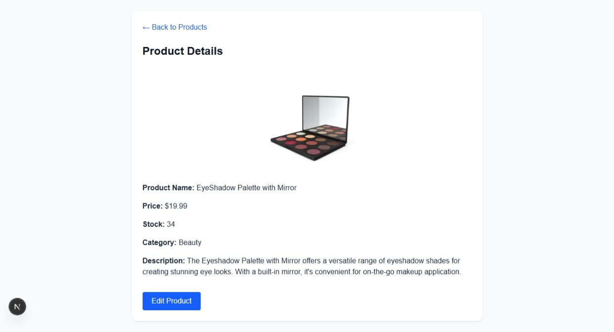

# Product Admin Dashboard

A responsive Product Admin Dashboard built using **Next.js, TypeScript, Tailwind CSS, and Axios**. This application helps users manage products with features like adding, viewing, editing, deleting, searching, filtering, sorting, and pagination.

## 🚀 Features

- User Login and Logout
- View all products
- Add new products
- Edit and update product details
- Delete products
- Search products
- Filter products by category
- Sort products by title, price, and rating
- Pagination with 10, 20, and 50 products per page
- Dashboard summary cards:
  - Total Products
  - Total Categories
  - Total Stock
  - Low Stock
- Responsive user interface
- Local storage support for product changes

## 🛠️ Technologies Used

- Next.js
- React
- TypeScript
- Tailwind CSS
- Axios
- DummyJSON API
- Browser Local Storage

## 📂 Project Structure

```text
product-admin-dashboard/
├── api/
├── app/
│   └── products/
├── context/
├── types/
├── utils/
├── package.json
└── README.md
```

## ⚙️ Installation and Setup

1. Clone the repository:

```bash
git clone https://github.com/irfanasheerin22-cloud/product-admin-dashboard.git
```

2. Navigate to the project folder:

```bash
cd product-admin-dashboard
```

3. Install dependencies:

```bash
npm install
```

4. Start the development server:

```bash
npm run dev
```

5. Open your browser and visit:

```text
http://localhost:3000
```

## 🔗 API

This project uses the DummyJSON API to fetch product data.

https://dummyjson.com/products

## 👩‍💻 Developer

**Irfana Sheerin**

GitHub: https://github.com/irfanasheerin22-cloud

LinkedIn: https://linkedin.com/in/irfana-sheerin-064509378

---

⭐ If you find this project useful, feel free to explore the repository!
## 📸 Project Screenshots

### Dashboard


### Add Product


### View Product


### Edit Product

